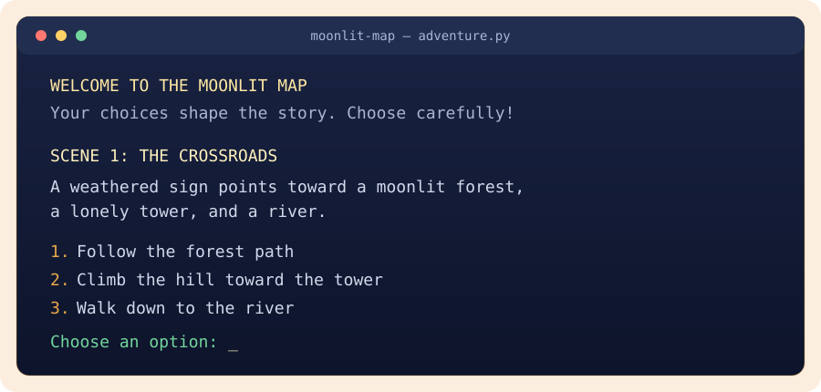

<div align="center">
  

  <h1>Moonlit Map Adventure</h1>

  <p><strong>A tiny command-line quest where every choice redraws the map.</strong></p>

  <p>
    <a href="https://github.com/Hasalawa/copilot-adventure-game/actions/workflows/ci.yml">
      
    </a>
    
    
  </p>
</div>

---

## ✦ Begin the adventure

You stand at a moonlit crossroads. A whispering forest, a clockwork tower,
and a starlit river each promise a different story. Choose carefully: your
decisions lead to hidden chambers, surprising allies, and several unique
endings.

```text
                 ✦
          .  *       .  *
       .       MOONLIT       .
              CROSSROADS
          /        |        \
      FOREST     TOWER     RIVER
```

This is a lightweight, replayable choose-your-own-adventure game written in
plain Python. There are no packages to install and no setup beyond Python 3.

## ✧ A glimpse inside

<div align="center">
  
</div>

## ✦ Features

| Feature | What to expect |
| --- | --- |
| **Branching story** | Explore forests, towers, rivers, gardens, and hidden chambers. |
| **Meaningful choices** | Your decisions shape which scenes and endings you discover. |
| **Replay support** | Start a new route after every ending and find another path. |
| **Friendly input** | Invalid choices are handled with a clear prompt to try again. |
| **Zero dependencies** | Runs with the Python standard library alone. |

## ▶ Run it locally

### Requirements

- Python **3.10 or newer**
- A terminal

### Start the game

```bash
git clone https://github.com/Hasalawa/copilot-adventure-game.git
cd copilot-adventure-game
python3 adventure.py
```

On systems where Python 3 is invoked as `python`:

```bash
python adventure.py
```

Choose a numbered option at each scene. When the story ends, enter `y` to
play again or any other response to leave the adventure.

## ✓ Quality checks

The repository includes a GitHub Actions workflow that checks Python syntax and
runs tests on pushes and pull requests across Python 3.10–3.13.

Run the syntax check locally:

```bash
python3 -m compileall -q .
```

Run tests when test files are present:

```bash
python3 -m unittest discover --start-directory . --pattern "test*.py" --verbose
```

## ✎ Contributing

New scenes, endings, story polish, tests, and documentation are welcome.
Please read [CONTRIBUTING.md](CONTRIBUTING.md) before opening a pull request.

Please also review the [Code of Conduct](CODE_OF_CONDUCT.md) and
[Security Policy](SECURITY.md).

## License

No license file has been added to this repository yet. Please contact the
repository maintainers before redistributing the project.

<div align="center">
  <br>
  <sub>Built with Python and GitHub Copilot · Choose wisely, traveler.</sub>
</div>
